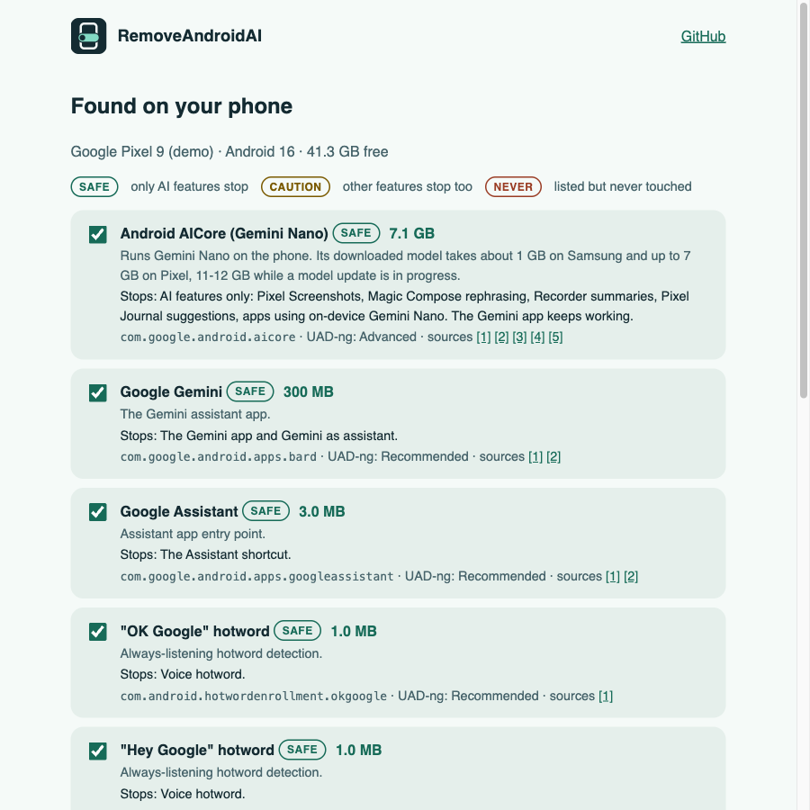
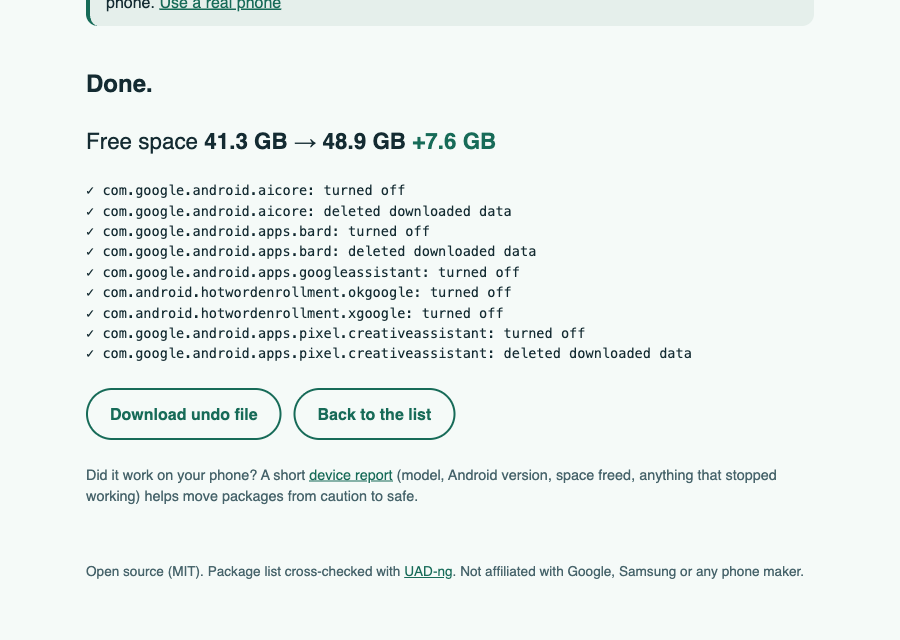

<p align="center">
  <picture>
    <source media="(prefers-color-scheme: light)" srcset="docs/banner-light.svg">
    
  </picture>
</p>

<p align="center">
  <b>Plug in your Android phone, click once: Gemini, AICore and Galaxy AI are off, and up to 7 GB of storage is back.<br>Every step can be undone.</b>
</p>

<p align="center">
  <a href="https://maximilianfeix.github.io/RemoveAndroidAI/"><b>Open the web app</b></a> ·
  <a href="https://maximilianfeix.github.io/RemoveAndroidAI/?demo">Try the demo (no phone needed)</a> ·
  <a href="#command-line">Command line</a> ·
  <a href="#what-it-turns-off">What it turns off</a> ·
  <a href="#undo">Undo</a>
</p>

<p align="center">
  <a href="https://github.com/maximilianfeix/RemoveAndroidAI/actions/workflows/ci.yml"></a>
  <a href="https://github.com/maximilianfeix/RemoveAndroidAI/releases/latest"></a>
  <a href="LICENSE"></a>
  
</p>

<table>
  <tr>
    <td width="50%"></td>
    <td width="50%"></td>
  </tr>
  <tr>
    <td align="center"><sub>Every AI package found, with size, tier and what else stops</sub></td>
    <td align="center"><sub>Free space measured before and after (demo mode, simulated Pixel 9)</sub></td>
  </tr>
</table>

---

Android phones now ship with on-device AI that downloads large models in the background. Google says AICore, which runs Gemini Nano, normally takes about 7 GB on a Pixel and 11 GB or more while a model update is in progress ([Google](https://support.google.com/android/answer/17065362), [Tech Advisor](https://www.techadvisor.com/article/3094321/how-to-free-up-to-7gb-on-your-pixel-phone.html)). Samsung, Xiaomi, Motorola and OnePlus add their own AI engines on top.

RemoveAndroidAI is the Android sibling of [RemoveWindowsAI](https://github.com/zoicware/RemoveWindowsAI) and [RemoveMacAI](https://github.com/omlahore/RemoveMacAI). It finds the AI packages on your phone, tells you what each one does and what stops working without it, and turns off the ones you pick.

- **No root, no app to install on the phone.** It uses Android's own `pm disable-user`, the same switch as *Settings → Apps → Disable*.
- **Nothing is uninstalled.** Turned-off packages stay on the phone and can be turned back on at any time.
- **Every change is recorded** in an undo file, so one click or one command puts everything back.
- **Conservative by default.** Only packages whose loss affects AI features alone are pre-selected. Packages that also break other features (Live Caption, search, autofill) are listed but left unticked. Packages known to break phones are listed and never touched.
- **Every package has a source.** The list is cross-checked against [Universal Android Debloater (next generation)](https://github.com/Universal-Debloater-Alliance/universal-android-debloater-next-generation) and links its evidence.

## Use it

You need a computer, a USB cable and **USB debugging** turned on:
*Settings → About phone → tap Build number 7 times*, then *Settings → System → Developer options → USB debugging*.
On Samsung, Build number is under *About phone → Software information*.

### In the browser

Open **https://maximilianfeix.github.io/RemoveAndroidAI/** in Chrome, Edge, Brave or Opera, click **Connect phone**, and tap **Allow** on the phone. The page talks to the phone directly over WebUSB. Nothing is uploaded anywhere.

If the browser can't claim the phone, another program is holding the USB connection: close Android Studio and run `adb kill-server`.

### Command line

Needs Node.js 20+ and `adb` ([platform-tools](https://developer.android.com/tools/releases/platform-tools); macOS: `brew install android-platform-tools`, Windows: `winget install Google.PlatformTools`).

```sh
npx github:maximilianfeix/RemoveAndroidAI            # show what would be turned off; changes nothing
npx github:maximilianfeix/RemoveAndroidAI --apply    # turn it off (asks first)
npx github:maximilianfeix/RemoveAndroidAI --undo     # turn everything back on
```

Options: `--include-caution` also selects packages that break other features, `--serial <id>` picks a phone when several are connected, `--json` prints the scan as JSON, `--yes` skips the question.

The CLI prints free space before and after, measured with `df` on the phone, so the number is what you actually got back.

### With a coding agent

Point Claude Code, Codex or any agent with a shell at this repo and say *"turn off the AI on my phone"*. [AGENTS.md](AGENTS.md) tells it how to do that safely.

## Undo

- **Web:** the page keeps an undo record in your browser and offers it as a file to download. Reconnect and click **Undo last run**, or **Undo from file**.
- **CLI:** `--undo` uses the record saved in `~/.removeandroidai/`.
- **By hand:** *Settings → Apps → (show system apps) → the app → Enable*, or `adb shell pm enable --user 0 <package>`.

Undo only turns back on what RemoveAndroidAI turned off. Apps you had disabled yourself stay disabled.

Model data deleted with `pm clear` is not restored by undo. The apps download it again when they need it.

## What it turns off

Tiers:

- **safe:** only AI features stop. These are pre-selected.
- **caution:** other features stop too, or the package isn't in UAD-ng's list yet, so its side effects are unverified. These are not pre-selected.
- **never:** listed so they can't be removed by mistake. RemoveAndroidAI refuses to touch them.

Google packages are checked on every phone; vendor packages only on that vendor's phones.

<!-- packages:start -->

#### Google (any phone)

| Package | What | Tier | Stops | Sources |
|---|---|---|---|---|
| `com.google.android.aicore`<br>Android AICore (Gemini Nano) | Runs Gemini Nano on the phone. Its downloaded model takes about 1 GB on Samsung and up to 7 GB on Pixel, 11-12 GB while a model update is in progress. | **safe** (UAD-ng: Advanced) | AI features only: Pixel Screenshots, Magic Compose rephrasing, Recorder summaries, Pixel Journal suggestions, apps using on-device Gemini Nano. The Gemini app keeps working. | [1](https://play.google.com/store/apps/details?id=com.google.android.aicore) [2](https://support.google.com/android/answer/17065362) [3](https://www.techadvisor.com/article/3094321/how-to-free-up-to-7gb-on-your-pixel-phone.html) [4](https://www.androidauthority.com/disable-aicore-samsung-3635371/) [5](https://sysapps.bayton.org/packages/com.google.android.aicore) |
| `com.google.android.apps.bard`<br>Google Gemini | The Gemini assistant app. | **safe** (UAD-ng: Recommended) | The Gemini app and Gemini as assistant. | [1](https://play.google.com/store/apps/details?id=com.google.android.apps.bard) [2](https://github.com/Universal-Debloater-Alliance/universal-android-debloater-next-generation/blob/main/resources/assets/uad_lists.json) |
| `com.google.android.apps.googleassistant`<br>Google Assistant | Assistant app entry point. | **safe** (UAD-ng: Recommended) | The Assistant shortcut. | [1](https://play.google.com/store/apps/details?id=com.google.android.apps.googleassistant) [2](https://github.com/Universal-Debloater-Alliance/universal-android-debloater-next-generation/blob/main/resources/assets/uad_lists.json) |
| `com.android.hotwordenrollment.okgoogle`<br>"OK Google" hotword | Always-listening hotword detection. | **safe** (UAD-ng: Recommended) | Voice hotword. | [1](https://github.com/Universal-Debloater-Alliance/universal-android-debloater-next-generation/blob/main/resources/assets/uad_lists.json) |
| `com.android.hotwordenrollment.xgoogle`<br>"Hey Google" hotword | Always-listening hotword detection. | **safe** (UAD-ng: Recommended) | Voice hotword. | [1](https://github.com/Universal-Debloater-Alliance/universal-android-debloater-next-generation/blob/main/resources/assets/uad_lists.json) |
| `com.google.android.apps.aiwallpapers`<br>AI Wallpapers | Generative wallpapers. | **safe** (UAD-ng: Recommended) | Creating AI wallpapers. | [1](https://github.com/Universal-Debloater-Alliance/universal-android-debloater-next-generation/blob/main/resources/assets/uad_lists.json) |
| `com.google.android.apps.pixel.creativeassistant`<br>Pixel Studio | AI image generation. | **safe** (UAD-ng: Advanced) | Pixel Studio. | [1](https://github.com/Universal-Debloater-Alliance/universal-android-debloater-next-generation/blob/main/resources/assets/uad_lists.json) |
| `com.google.android.apps.pixel.agent`<br>Pixel Screenshots | AI screenshot search app (Pixel 9 and later). | **caution** (UAD-ng: absent) | Pixel Screenshots. Not in UAD-ng's list; other side effects are unverified. | [1](https://sysapps.bayton.org/packages/com.google.android.apps.pixel.agent) [2](https://support.google.com/pixelphone/answer/15312581) |
| `com.google.android.as`<br>Android System Intelligence | On-device machine learning for many system features, not only AI. | **caution** (UAD-ng: Recommended) | Live Caption, smart text selection, app predictions in the launcher, notification smart actions, Screen Attention, smart replies, keyboard suggestions. | [1](https://play.google.com/store/apps/details?id=com.google.android.as) [2](https://milaq.net/android-bloatware) [3](https://github.com/Universal-Debloater-Alliance/universal-android-debloater-next-generation/blob/main/resources/assets/uad_lists.json) |
| `com.google.android.as.oss`<br>Private Compute Services | Privacy bridge that Android System Intelligence and AICore use to reach the network. | **caution** (UAD-ng: Recommended) | Live Caption, Now Playing music recognition, smart replies. | [1](https://play.google.com/store/apps/details?id=com.google.android.as.oss) [2](https://github.com/google/private-compute-services) |
| `com.android.settings.intelligence`<br>Settings Suggestions (not AI) | Settings search. Listed so it is never turned off by mistake. | **never** (UAD-ng: Expert) | Settings crashes when you search. | [1](https://gitlab.com/W1nst0n/universal-android-debloater/-/issues/51) |

#### Samsung

| Package | What | Tier | Stops | Sources |
|---|---|---|---|---|
| `com.samsung.android.bixby.agent`<br>Bixby Voice | Bixby assistant. | **caution** (UAD-ng: Recommended) | Bixby. One report from a Galaxy S25 of a 25% CPU loop after disabling Bixby; unverified, so it is opt-in. | [1](https://github.com/Universal-Debloater-Alliance/universal-android-debloater-next-generation/blob/main/resources/assets/uad_lists.json) [2](https://github.com/khlam/debloat-samsung-android/blob/master/commands.txt) [3](https://www.reddit.com/r/GalaxyS25/comments/1uvm6ju/) |
| `com.samsung.android.bixby.wakeup`<br>Bixby voice wake-up | Bixby hotword. | **safe** (UAD-ng: Recommended) | Bixby wake word. | [1](https://github.com/khlam/debloat-samsung-android/blob/master/commands.txt) |
| `com.samsung.android.visionintelligence`<br>Bixby Vision | Camera object recognition. | **safe** (UAD-ng: Recommended) | Bixby Vision. | [1](https://github.com/khlam/debloat-samsung-android/blob/master/commands.txt) |
| `com.samsung.android.bixbyvision.framework`<br>Bixby Vision Framework | Bixby Vision backend. | **safe** (UAD-ng: Recommended) | Bixby Vision. | [1](https://github.com/khlam/debloat-samsung-android/blob/master/commands.txt) |
| `com.samsung.android.app.sketchbook`<br>Drawing Assist | AI drawing extension. | **safe** (UAD-ng: Recommended) | Drawing Assist. | [1](https://github.com/Universal-Debloater-Alliance/universal-android-debloater-next-generation/blob/main/resources/assets/uad_lists.json) |
| `com.samsung.android.app.interpreter`<br>Interpreter | Live translation app. | **safe** (UAD-ng: Advanced) | Interpreter and live translation. | [1](https://github.com/itxjobe/samsungdebloat/blob/main/04-optional-removals.txt) [2](https://github.com/Willie169/Samsung-Android-Debloat-List) |
| `com.samsung.android.aicore`<br>Samsung AI Core | Galaxy AI engine. | **caution** (UAD-ng: absent) | Reportedly Photo Assist, Note Assist and Writing Assist. One user removed it without problems, another list says keep it. Unverified. | [1](https://sysapps.bayton.org/packages/com.samsung.android.aicore) [2](https://github.com/itxjobe/samsungdebloat/blob/main/06-oneui8-specific.txt) [3](https://github.com/Willie169/Samsung-Android-Debloat-List/blob/main/raw.txt) |
| `com.samsung.android.offline.languagemodel`<br>Samsung Language Core | Offline language model, up to about 3 GB. | **caution** (UAD-ng: absent) | Offline Galaxy AI language features; Samsung Keyboard may use it. Exact scope unverified. | [1](https://sysapps.bayton.org/packages/com.samsung.android.offline.languagemodel) |
| `com.samsung.android.vision.model`<br>Samsung Vision Model | Vision model files for Galaxy AI, up to about 1.6 GB. | **caution** (UAD-ng: absent) | Vision AI features. Unverified. | [1](https://sysapps.bayton.org/packages/com.samsung.android.vision.model) [2](https://github.com/itxjobe/samsungdebloat/blob/main/08-z-fold8.txt) |
| `com.samsung.android.intellivoiceservice`<br>Samsung Intelligence Voice Services | Bridge to Galaxy AI speech and language services. | **caution** (UAD-ng: absent) | Live Translate and speech recognition. | [1](https://sysapps.bayton.org/packages/com.samsung.android.intellivoiceservice) [2](https://github.com/itxjobe/samsungdebloat/blob/main/package-reference.md) |
| `com.samsung.android.visual.cloudcore`<br>Samsung Visual Cloud Core | Sends generative image edits to the cloud. | **caution** (UAD-ng: absent) | Cloud generative photo edits. Unverified. | [1](https://github.com/Willie169/Samsung-Android-Debloat-List/blob/main/raw.txt) |
| `com.samsung.android.photoremasterservice`<br>Photo Remaster | AI photo enhancement. | **caution** (UAD-ng: Advanced) | Gallery Photo Remaster. | [1](https://github.com/Universal-Debloater-Alliance/universal-android-debloater-next-generation/blob/main/resources/assets/uad_lists.json) |
| `com.samsung.android.smartsuggestions`<br>Smart suggestions / Now Brief | Now Brief, content capture and autofill suggestions. | **caution** (UAD-ng: Recommended) | Now Brief and autofill suggestions. | [1](https://github.com/itxjobe/samsungdebloat/blob/main/CHANGELOG.md) |
| `com.samsung.android.scs`<br>Samsung Core Services | Search and text/image extraction engine. | **caution** (UAD-ng: Advanced) | Search and text extraction in Camera, Gallery, Messages, Contacts, Settings and Finder. | [1](https://sysapps.bayton.org/packages/com.samsung.android.scs) |
| `com.samsung.android.callassistant`<br>Call Assistant | Call screening and call AI. | **never** (UAD-ng: Expert) | UAD-ng: can break things on One UI 6.1 and later. | [1](https://github.com/Universal-Debloater-Alliance/universal-android-debloater-next-generation/blob/main/resources/assets/uad_lists.json) |
| `com.samsung.android.honeyboard`<br>Samsung Keyboard (hosts Writing Assist) | The system keyboard. | **never** (UAD-ng: Expert) | You can get stuck at the lock screen without another keyboard that works before unlock. | [1](https://developer.android.com/training/articles/direct-boot) [2](https://github.com/itxjobe/samsungdebloat/blob/main/package-reference.md) |

#### Xiaomi / Redmi / POCO

| Package | What | Tier | Stops | Sources |
|---|---|---|---|---|
| `com.miui.voiceassist`<br>Mi AI (XiaoAi) | Voice assistant. | **safe** (UAD-ng: Recommended) | Mi AI. | [1](https://github.com/Universal-Debloater-Alliance/universal-android-debloater-next-generation/blob/main/resources/assets/uad_lists.json) |
| `com.xiaomi.mibrain.speech`<br>Mi AI speech engine | Speech engine for Mi AI. | **safe** (UAD-ng: Recommended) | Mi AI voice. | [1](https://github.com/Universal-Debloater-Alliance/universal-android-debloater-next-generation/blob/main/resources/assets/uad_lists.json) |
| `com.xiaomi.aiasst.service`<br>AI call assistant | AI features in calls. | **safe** (UAD-ng: Recommended) | AI call settings. | [1](https://github.com/Universal-Debloater-Alliance/universal-android-debloater-next-generation/blob/main/resources/assets/uad_lists.json) |
| `com.xiaomi.aicr`<br>HyperAI Engine | HyperOS AI engine. | **caution** (UAD-ng: Advanced) | May break setting wallpapers (UAD-ng issue #1110). | [1](https://github.com/Universal-Debloater-Alliance/universal-android-debloater-next-generation/issues/1110) [2](https://sysapps.bayton.org/packages/com.xiaomi.aicr) |
| `com.xiaomi.aiservice`<br>Xiaomi AI inference engine | On-device models for OCR and translation, downloaded silently. | **caution** (UAD-ng: Advanced) | HyperOS AI features such as OCR and translation. | [1](https://github.com/Universal-Debloater-Alliance/universal-android-debloater-next-generation/blob/main/resources/assets/uad_lists.json) |
| `com.xiaomi.cameramind`<br>Camera AI core | AI features of the stock camera. | **caution** (UAD-ng: Advanced) | Stock camera AI features; the camera app depends on it. | [1](https://github.com/Universal-Debloater-Alliance/universal-android-debloater-next-generation/blob/main/resources/assets/uad_lists.json) |

#### Motorola

| Package | What | Tier | Stops | Sources |
|---|---|---|---|---|
| `com.motorola.aiservices`<br>Moto AI Services | Supplies AI models to Motorola apps. | **safe** (UAD-ng: Recommended) | Moto AI model features. | [1](https://play.google.com/store/apps/details?id=com.motorola.aiservices) |
| `com.motorola.uxcore`<br>Moto AI | Moto AI hub app. | **caution** (UAD-ng: absent) | Moto AI features. Side effects unverified. | [1](https://play.google.com/store/apps/details?id=com.motorola.uxcore) [2](https://www.androidcentral.com/apps-software/motorola-moto-ai) |
| `com.motorola.aicore`<br>Moto AI Core | Supplies AI models to Motorola apps. | **caution** (UAD-ng: absent) | Unverified. | [1](https://play.google.com/store/apps/details?id=com.motorola.aicore) |

#### OnePlus / Oppo / Realme

| Package | What | Tier | Stops | Sources |
|---|---|---|---|---|
| `com.oplus.aiwriter`<br>AI Writer | AI text generation pop-up. | **safe** (UAD-ng: Recommended) | AI Writer. | [1](https://github.com/Universal-Debloater-Alliance/universal-android-debloater-next-generation/blob/main/resources/assets/uad_lists.json) |
| `com.heytap.speechassist`<br>Breeno Voice | Voice assistant. | **safe** (UAD-ng: Recommended) | Breeno. | [1](https://github.com/Universal-Debloater-Alliance/universal-android-debloater-next-generation/blob/main/resources/assets/uad_lists.json) |
| `com.oplus.aiunit`<br>AIUnit | ColorOS AI system service. | **caution** (UAD-ng: Advanced) | Smart Cutout, AI Editor and gallery AI. | [1](https://github.com/Universal-Debloater-Alliance/universal-android-debloater-next-generation/blob/main/resources/assets/uad_lists.json) |
| `com.oplus.aimemory`<br>Mind Space | AI save and summarize. | **caution** (UAD-ng: Advanced) | Mind Space. | [1](https://github.com/Universal-Debloater-Alliance/universal-android-debloater-next-generation/blob/main/resources/assets/uad_lists.json) |
| `com.aiunit.aon`<br>AON Service | Sensor features, not only AI. | **never** (UAD-ng: Expert) | Smart rotation, smart always-on display, privacy protection. | [1](https://community.oppo.com/thread/1446120575440257025) |

<!-- packages:end -->

Missing a package, or found one that breaks something? [Open an issue](https://github.com/maximilianfeix/RemoveAndroidAI/issues/new) with the phone model, Android version and a source. The list lives in [`data/packages.json`](data/packages.json).

## How it works

1. Reads the phone's maker and Android version (`getprop`) and the installed packages for the main user (`pm list packages --user 0`).
2. Matches them against [`data/packages.json`](data/packages.json) and reads sizes from Android's daily storage stats (`dumpsys diskstats`).
3. For each package you pick: `pm disable-user --user 0 <package>`, then, for packages that hold downloaded models, `pm clear --user 0 <package>` to delete them.
4. Writes each change to the undo record as it happens, then measures free space again with `df`.

Package names are checked against a strict pattern before they reach the shell, and a package marked *never* is refused even if it is passed in directly.

## Status

Version 0.2. The commands and output parsing are tested against an Android 16 emulator and a simulated phone in the test suite. **It has not yet been tested on enough real phones**: a [device report](https://github.com/maximilianfeix/RemoveAndroidAI/issues/new?template=device-report.yml) with what was freed and what stopped working on your phone is the most useful thing you can send. Some vendor packages are marked *caution* only because nobody has verified their side effects yet.

Use it at your own risk. Nothing here is permanent, but a phone without a feature you relied on is annoying even when it's reversible.

## Development

```sh
npm install
npm run check        # typecheck, tests, CLI bundle and web build
npm run dev          # web app on localhost (WebUSB works on localhost)
node scripts/readme-table.mjs   # regenerate the table above from data/packages.json
```

`dist/cli.mjs` is committed on purpose so `npx github:…` works without a build step. Rebuild it with `npm run build:cli` when you change `src/`.

## License

MIT. Not affiliated with Google, Samsung, Xiaomi, Motorola, OnePlus or Oppo. Product names are used only to describe what the tool turns off.
